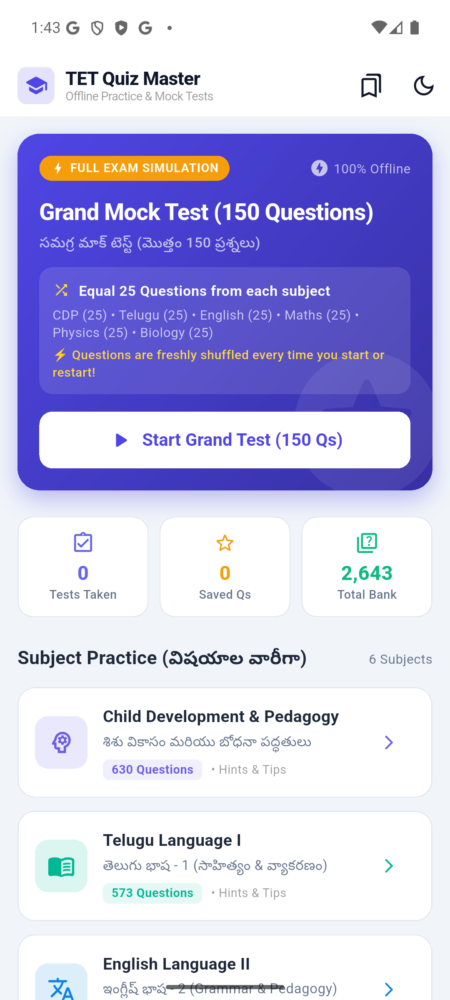

# 📚 TET Practice App (TET Quiz Master)

An all-in-one Flutter preparation and practice quiz application for the Teacher Eligibility Test (TET), featuring multiple subject quizzes, grand mock tests, bookmarking, and offline practice with curated Telugu and English question banks.

---

## 🚀 Features

- **📖 Subject-Wise Practice**:
  - **Child Development & Pedagogy (CDP)**
  - **Telugu (తెలుగు)**
  - **English**
  - **Mathematics**
  - **Physical Science / Physics**
  - **Biological Science / Biology**
- **🏆 Grand Mock Test**: Full-length exam simulation with randomized questions and timer.
- **🔖 Bookmark System**: Save challenging questions and revisit them anytime.
- **📊 Real-Time Scorecard & Review**: Immediate feedback, detailed explanations, and performance metrics.
- **📴 Offline Ready**: Preloaded JSON question banks with thousands of questions.
- **🎨 Modern UI**: Clean, responsive Flutter design with smooth transitions and bilingual support.

---

## 📱 Screenshots

| Home & Subjects | Live Quiz Screen | Grand Mock Test |
| :---: | :---: | :---: |
|  |  |  |

---

## 📁 Repository Structure

```
├── tet_quiz_app/             # Flutter mobile application
│   ├── lib/                  # Dart application source code
│   │   ├── main.dart         # App entry point
│   │   ├── models/           # Question & quiz models
│   │   ├── screens/          # Home, Quiz, Grand Test, Bookmarks screens
│   │   └── services/         # Question repository & bookmark manager
│   ├── assets/data/          # Bundled subject question JSON files
│   └── pubspec.yaml          # Flutter dependencies and assets config
├── extract_*.py              # Question extraction & OCR processing scripts
├── enrich_maths.py           # Mathematical explanation formatting scripts
├── *.json                    # Master subject question banks
├── TET_Test_Practice_v1.0.apk# Compiled ready-to-install Android APK
└── README.md
```

---

## 🛠️ Getting Started

### Prerequisites

- [Flutter SDK](https://docs.flutter.dev/get-started/install) (v3.11.5 or newer)
- Android Studio / Xcode / VS Code with Flutter extension
- Android device or emulator (Android 5.0+ / API 21+)

### Running the App

1. Navigate to the Flutter app directory:
   ```bash
   cd tet_quiz_app
   ```

2. Install dependencies:
   ```bash
   flutter pub get
   ```

3. Run the application:
   ```bash
   flutter run
   ```

### Building the APK

To generate a release APK:
```bash
cd tet_quiz_app
flutter build apk --release
```
The output APK will be generated at `tet_quiz_app/build/app/outputs/flutter-apk/app-release.apk`.

---

## 📦 Ready-to-Install APK

Pre-built APKs are available directly in this repository:
- `TET_Test_Practice_v1.0.apk`
- `TET_Quiz_Master_v1.0.apk`

---

## 📄 License

This project is maintained for TET examination preparation. All question banks and resources are for educational practice.
